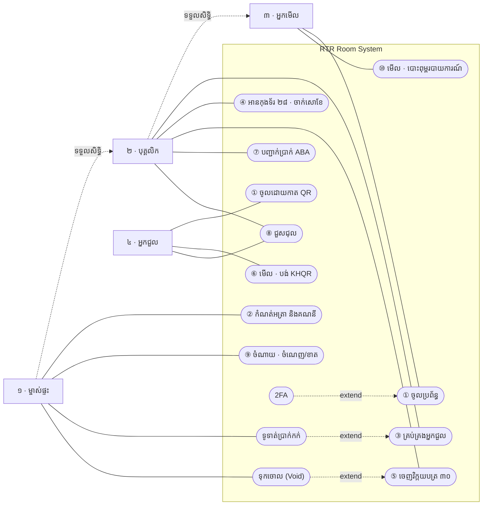

# ២. តួអង្គ និង Use Case

## តួអង្គ ៤ តាមលំដាប់

| លេខ | តួអង្គ | ចូលតាម | ធ្វើអ្វី |
| --- | --- | --- | --- |
| ១ | ម្ចាស់ផ្ទះ | ទូរស័ព្ទ + ពាក្យសម្ងាត់ (+ 2FA) | គ្រប់យ៉ាង រួមទាំងប្រាក់ ការកំណត់ គណនី |
| ២ | បុគ្គលិក | ទូរស័ព្ទ + ពាក្យសម្ងាត់ (+ 2FA) | អានកុងទ័រ វិក្កយបត្រ ទទួលប្រាក់ ជួសជុល |
| ៣ | អ្នកមើល | ទូរស័ព្ទ + ពាក្យសម្ងាត់ | មើល និងបោះពុម្ពតែប៉ុណ្ណោះ |
| ៤ | អ្នកជួល | កាត QR + លេខទូរស័ព្ទ | Portal៖ មើលវិក្កយបត្រ បង់ KHQR ស្នើជួសជុល |

ម្ចាស់ផ្ទះបង្កើតគណនីមុនគេ ហើយអ្នកជួលទទួលកាត QR ចុងក្រោយ។ ម្ចាស់ផ្ទះមានសិទ្ធិទាំងអស់របស់បុគ្គលិក ហើយបុគ្គលិកមានសិទ្ធិទាំងអស់របស់អ្នកមើល។

## Use Case Diagram

## តារាងសិទ្ធិ

| ការងារ | ១ ម្ចាស់ផ្ទះ | ២ បុគ្គលិក | ៣ អ្នកមើល | ៤ អ្នកជួល |
| --- | --- | --- | --- | --- |
| មើលបន្ទប់ អ្នកជួល វិក្កយបត្រទាំងអស់ | ✔ | ✔ | ✔ | ✘ (តែខ្លួនឯង) |
| អានកុងទ័រ និងចាក់សោខែ | ✔ | ✔ | ✘ | ✘ |
| បន្ថែម/កែអ្នកជួល ចាកចេញ | ✔ | ✔ | ✘ | ✘ |
| ចេញវិក្កយបត្រ ទទួលប្រាក់ បញ្ជាក់ ABA | ✔ | ✔ | ✘ | ✘ |
| ស្នើ / ឆ្លើយជួសជុល | ✔ | ✔ | ✘ | ✔ (ស្នើ យល់ព្រម) |
| Void បើកសោខែ ទូទាត់ប្រាក់កក់ | ✔ | ✘ | ✘ | ✘ |
| អត្រាថ្លៃ KHQR ចំណាយ គណនី | ✔ | ✘ | ✘ | ✘ |
| បង់ KHQR ផ្ញើបង្កាន់ដៃ ជូនដំណឹងចាកចេញ | ✘ | ✘ | ✘ | ✔ |
