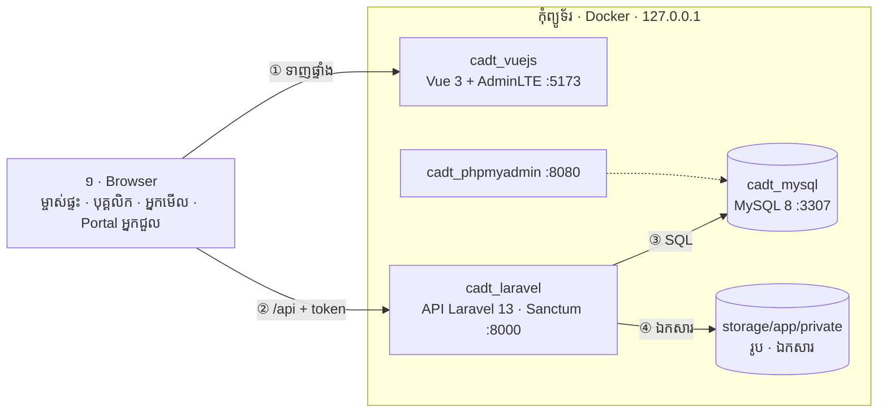

# ៣. ស្ថាបត្យកម្ម

## Container

Browser ទាញផ្ទាំង Vue ហើយផ្ទាំងហៅ API Laravel តែមួយ។ ច្បាប់គណនា និងសិទ្ធិ មានតែនៅ API។

| Container | Image | Port |
| --- | --- | --- |
| `cadt_mysql` | `mysql:8.0` + volume `mysql_data` | 127.0.0.1:3307 |
| `cadt_laravel` | `docker/laravel` (PHP 8.3 + Composer + GD) | 127.0.0.1:8000 |
| `cadt_vuejs` | `docker/vuejs` (Node 22) | 127.0.0.1:5173 |
| `cadt_phpmyadmin` | `phpmyadmin` | 127.0.0.1:8080 |

## ស្រទាប់កូដ Laravel (តាមលំដាប់សំណើ)

| លំដាប់ | ស្រទាប់ | ថត | ធ្វើអ្វី |
| --- | --- | --- | --- |
| ① | Route | `routes/api.php` | ក្រុម route តាមតួនាទី |
| ② | Middleware | `app/Http/Middleware` | `auth:sanctum` · `role:` · `log.activity` · `throttle` · `signed` |
| ③ | Request / Controller | `app/Http/Controllers` | ពិនិត្យទិន្នន័យចូល ហើយហៅ Service |
| ④ | Service | `app/Services` | ច្បាប់អាជីវកម្ម៖ `InvoiceService` `MeterReadingService` `DepositService` `PaymentProofService` … |
| ⑤ | Model / Resource | `app/Models` · `Http/Resources` | MySQL ↔ JSON |

## ស្រទាប់ Vue

| ថត | តួនាទី |
| --- | --- |
| `router/` | ផ្លូវទំព័រ និងការការពារតាមតួនាទី |
| `pages/` · `components/` | ទំព័រតាមម៉ូឌុល |
| `services/` | ហៅ API តាម `http.js` |
| `stores/` | ស្ថានភាពរួម (អ្នកប្រើ ស្លាក គ្រាប់រោទ៍) |
| `i18n/` · `help/` | ខ្មែរ/អង់គ្លេស · ជំនួយ |

## សុវត្ថិភាព ៥ ជាន់

| លំដាប់ | ជាន់ | វិធានការ |
| --- | --- | --- |
| ① | បណ្តាញ | Port ទាំងអស់នៅ 127.0.0.1 |
| ② | ការចូល | ពាក្យសម្ងាត់ ≥ ៨ តួ + 2FA · កាត QR + ទូរស័ព្ទ · ៥ ដង/នាទី |
| ③ | Token | Laravel Sanctum |
| ④ | សិទ្ធិ | `role:` ពិនិត្យរៀងរាល់សំណើ · អ្នកជួលឃើញតែបន្ទប់ខ្លួន |
| ⑤ | ទិន្នន័យ | ឯកសារឯកជន + តំណ `signed` មានកំណត់ពេល · `.env` មិនចូល Git |

## គុណភាព

- Laravel feature tests (រួម `BillingDaysTest`, `DemoDataTest`) លើ SQLite ក្នុង memory។
- GitHub Actions៖ ① Laravel tests → ② `composer audit` → ③ Vue build រៀងរាល់ push។
