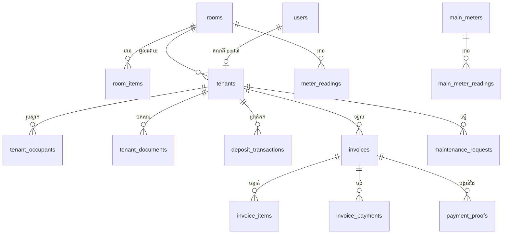

# ៤. គំរូទិន្នន័យ (ERD)

តារាងកណ្តាលគឺ `rooms` និង `tenants`។ លេខ ①–⑥ = លំដាប់ដែលទិន្នន័យកើតឡើង។

| លំដាប់ | ក្រុម | តារាង |
| --- | --- | --- |
| ① | គណនី និងការកំណត់ | `users` · `personal_access_tokens` · `settings` · `activity_logs` |
| ② | បន្ទប់ | `rooms` · `room_items` |
| ③ | អ្នកជួល និងប្រាក់កក់ | `tenants` · `tenant_occupants` · `tenant_documents` · `move_in_payments` · `deposit_transactions` · `deposit_settlements` · `move_out_notices` |
| ④ | ទឹកភ្លើង | `meter_readings` · `meter_replacements` · `main_meters` · `main_meter_readings` |
| ⑤ | វិក្កយបត្រ និងប្រាក់ | `invoices` · `invoice_items` · `invoice_payments` · `payment_proofs` |
| ⑥ | ជួសជុល និងចំណាយ | `maintenance_requests` · `announcements` · `expenses` · `recurring_expenses` |

ច្បាប់សំខាន់៖ វិក្កយបត្រមិនលុបទេ តែទុកចោល (Void)។ លេខកុងទ័រដែលមានវិក្កយបត្ររួច កែមិនបាន។ រូបឯកសារនៅក្នុង `storage/app/private` ហើយ database កត់តែផ្លូវ។
