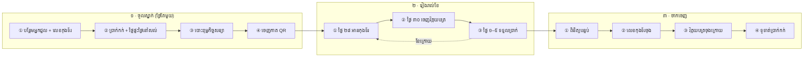
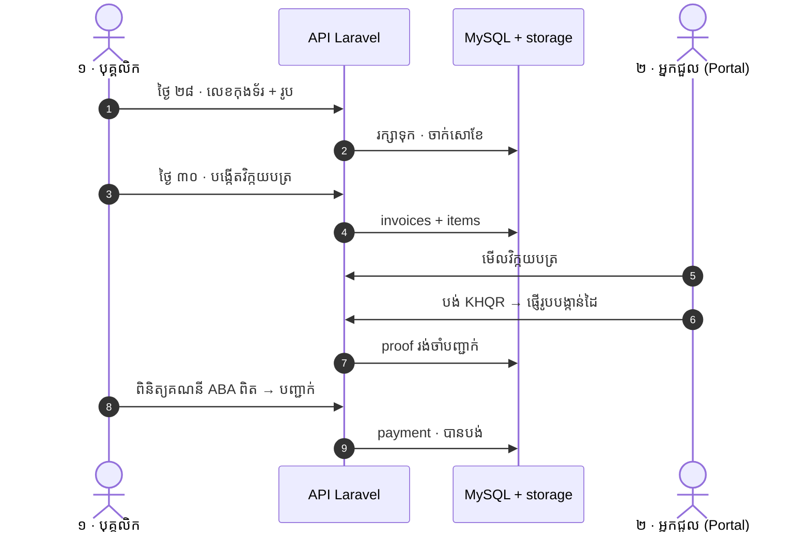
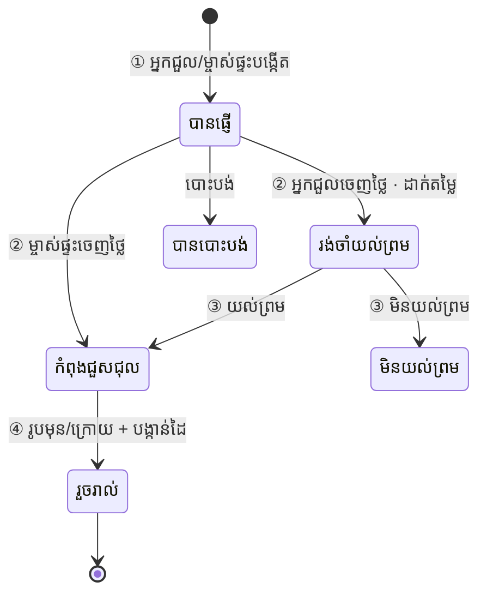

# ៥. លំហូរការងារ

## វដ្តអ្នកជួល

## ថ្ងៃ ២៨ និង ៣០

- អានកុងទ័រថ្ងៃ **២៨** · ចេញវិក្កយបត្រថ្ងៃ **៣០** (ខែកុម្ភៈ៖ ថ្ងៃចុងខែ)។
- វិក្កយបត្រខែ P = ទឹកភ្លើងខែ P + ថ្លៃផ្ទះខែ P+1។
- ប្រាក់ចូលស្នាក់ = ប្រាក់កក់ + ថ្លៃផ្ទះ × ថ្ងៃនៅសល់ ÷ ថ្ងៃក្នុងខែ។

| ករណី (ថ្លៃផ្ទះ $120 សាកល្បង) | ① ថ្ងៃចូល | ② វិក្កយបត្រ ៣០/១១ | ③ វិក្កយបត្រ ៣០/១២ |
| --- | --- | --- | --- |
| ក · ចូល ១៥/១១ | $64 (១៦ ថ្ងៃ) | ថ្លៃផ្ទះធ្នូ + ទឹកភ្លើង ១៥–២៨/១១ | ធម្មតា |
| ខ · ចូល ២៩/១១ | $8 (២ ថ្ងៃ) | ថ្លៃផ្ទះធ្នូតែប៉ុណ្ណោះ (ស្លាក «ថ្លៃផ្ទះតែប៉ុណ្ណោះ») | + ទឹកភ្លើង ២៩/១១–២៨/១២ |
| គ · ចូល ០១/១២ | ថ្លៃផ្ទះធ្នូពេញ | គ្មាន (ស្លាក «គ្មានអ្វីត្រូវគិត») | ទឹកភ្លើង ០១–២៨/១២ |

## ចេញវិក្កយបត្រ និងបង់ប្រាក់

ច្បាប់ការពារប្រាក់៖ រូប ឬលេខប្រតិបត្តិការដដែលផ្ញើពីរដងមិនបាន · បញ្ជាក់លើសប្រាក់ជំពាក់មិនបាន · ថ្ងៃបង់មិននៅអនាគត។

## ស្ថានភាពជួសជុល

របៀបបង់ថ្លៃជួសជុល ៣៖ បង់មុនពេលជួសជុល · បង់ភ្លាមពេលរួច · បូកក្នុងវិក្កយបត្រខែបន្ទាប់។
